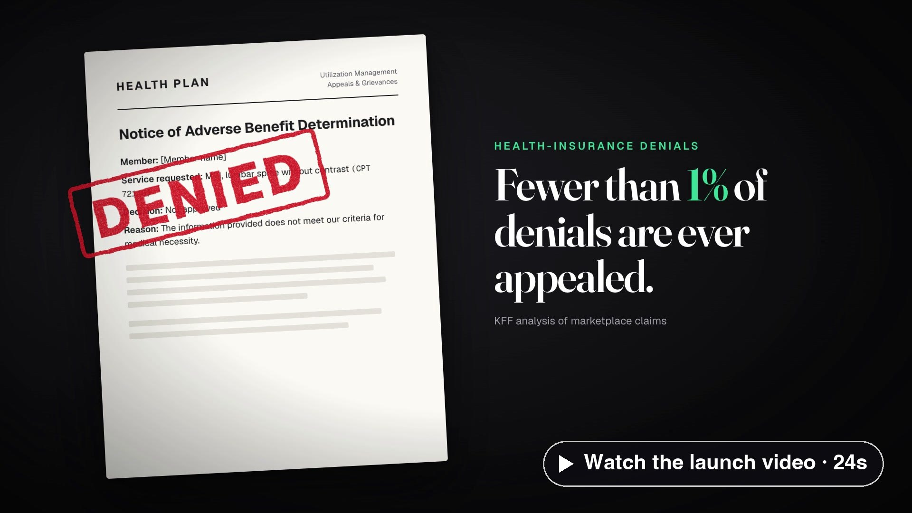
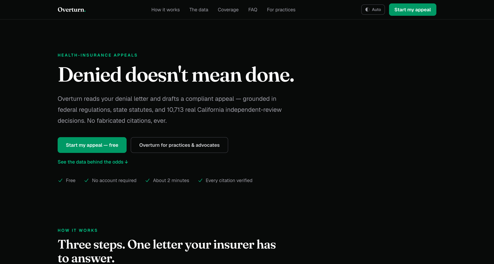
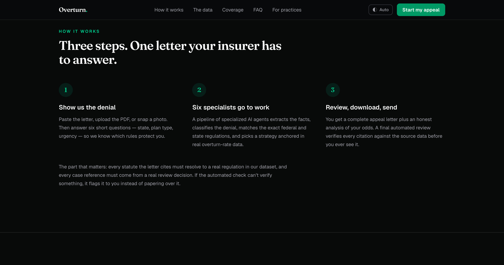
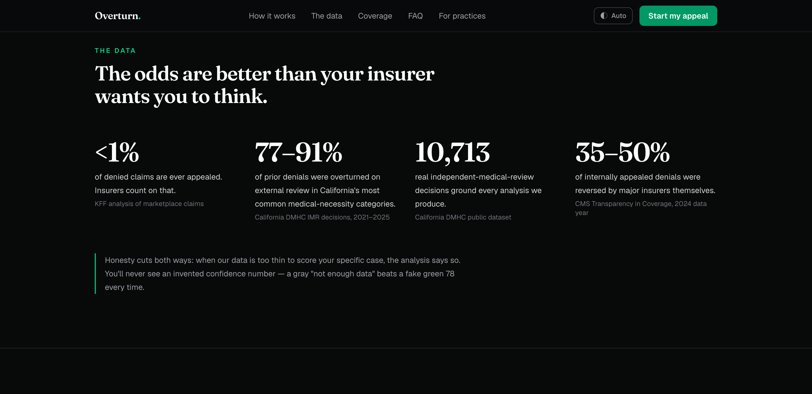
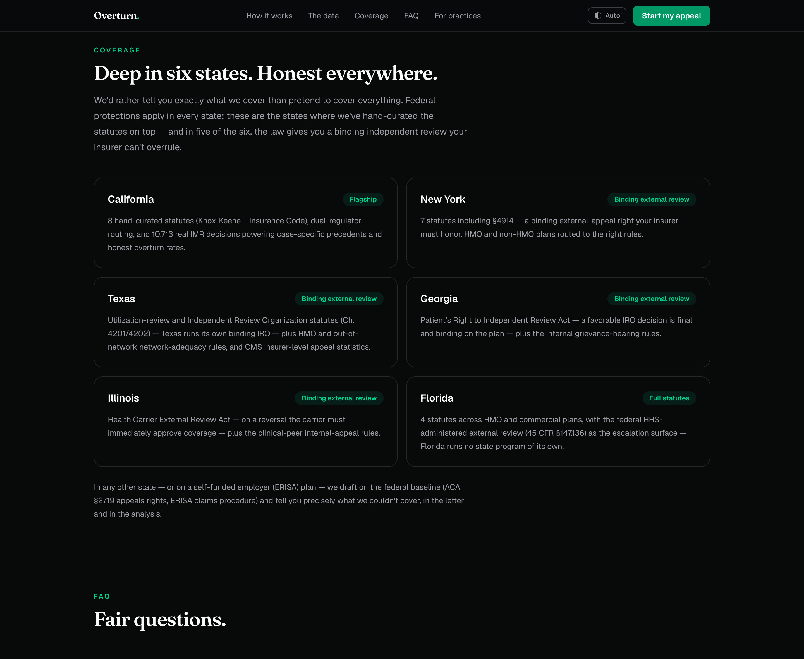

# Overturn

6-agent AI pipeline that generates legally-grounded health insurance appeal letters — taking a denied claim from raw PDF to a fully cited, jurisdiction-aware appeal document.

▶ Launch video: [landscape 16:9 · 24s](media/overturn-launch-16x9.mp4) · [vertical 9:16 for mobile · 24s](media/overturn-launch-9x16.mp4)

**Live:** https://overturn.co

---

## What it does

Health insurance denials are overturned 77–91% of the time on external review in the most common categories — but most people never appeal because they don't know how. Overturn closes that gap with a pipeline that does in seconds what a healthcare attorney would charge hundreds of dollars for.

### The 6-agent pipeline (sequential, no shortcuts)

1. **Extraction** — Vision-LLM OCR parses denial letters including image-only PDFs
2. **Classification** — identifies denial type (medical necessity, prior auth, out-of-network, ERISA)
3. **Regulation** — pure data filter, zero hallucination — matches applicable federal and state statutes
4. **Strategy** — selects legal angle, attaches real DMHC IMR precedents for CA claims
5. **Writer** — composes the letter in the user's voice with deterministic statute citations
6. **Review** — final QA gate blocks the letter if any citation doesn't trace back to verified source data

### Hard constraints enforced in code

- No fabricated citations — every statute must resolve to a verified ID
- ERISA preemption gate for self-funded employer plans
- Jurisdiction guard — CA precedents never shown to non-CA users
- CC-BY attribution on all DMHC case references

### Data foundation

- 10,713 California DMHC IMR decisions
- 40 regulation records
- 50 CARC/RARC denial codes
- Cost per run: ~$0.025

---

## Stack

TypeScript (npm workspaces) · Express + BullMQ · Next.js 16 · Expo (mobile) · Redis · Postgres · OpenRouter (DeepSeek + Claude Sonnet) · pdfkit

---

## Screenshots

| | |
|---|---|
|  overturn.co |  Three steps: upload the denial, six agents work, download the letter |
|  The data behind the odds |  Hand-curated statutes in six states, honest about the rest |
